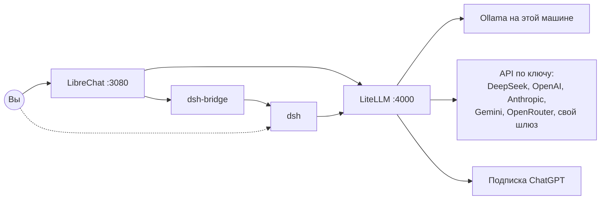

# llm-stack

Локальный стек из трёх частей, запуск одной командой:

| Часть | Что делает | Адрес |
|---|---|---|
| [LibreChat](https://github.com/LibreChat-AI/LibreChat) | Чат, агенты и MCP | http://localhost:3080 |
| [LiteLLM](https://github.com/BerriAI/litellm) | Единый шлюз моделей: ключи, учёт запросов и расходов | http://localhost:4000/ui |
| [DeepSeek Harness](https://github.com/deepseek-ai/deepseek-harness) (`dsh`) | Агент для работы с кодом и файлами; управляется из LibreChat | в LibreChat: endpoint «DeepSeek Harness»; свой интерфейс — по ссылке из `deploy.sh` |



Модели настраиваются только в LiteLLM. LibreChat и dsh получают их список оттуда, поэтому каждый запрос виден в учёте LiteLLM.

Задачи для dsh ставятся прямо в LibreChat: выберите endpoint **DeepSeek Harness**. Сообщение уходит в dsh без участия модели LibreChat. Подробно: [docs/dsh-in-librechat.md](docs/dsh-in-librechat.md).

## Запуск

Нужны Docker (на Windows — внутри WSL), `git`, `curl`, `openssl` и `python3`.

```bash
git clone https://github.com/DemonIngvi/llm-stack.git
cd llm-stack
bash deploy.sh
```

На Windows команда запускается из Git Bash: скрипт сам перейдёт в WSL. В конце он печатает ссылки, пароль LiteLLM и одноразовую ссылку входа в dsh.

Повторный запуск получает свежую версию репозитория и перезапускает стек. Данные при этом сохраняются.

## Добавить модель

```bash
bash add-model.sh ollama   qwen3:8b             # Ollama на этой машине
bash add-model.sh deepseek deepseek-v4-flash    # API по ключу, ключ спросит без вывода на экран
bash add-model.sh chatgpt  gpt-5.5              # подписка ChatGPT, разовый вход
bash add-model.sh mock                          # тестовая модель без ключей
bash add-model.sh list
```

Подробно, в том числе через интерфейс LiteLLM: [docs/models.md](docs/models.md).

## Безопасность

- **Порты** открыты только на `127.0.0.1`.
- **Секреты** создаются при первом запуске в `~/llm-stack/.env` и в Git не попадают. Ключи провайдеров LiteLLM хранит в своей базе в зашифрованном виде.
- **Образы** закреплены по версии и digest. Не используйте `latest`, `main-latest` и `main-stable` LiteLLM: 21 октября 2026 года под этими тегами публиковался вредоносный образ.
- **dsh** находится в developer preview и выполняет команды, которые пишет модель. Поэтому он работает в контейнере и видит только свою рабочую папку `~/llm-stack/dsh-workspace`. Другую папку можно передать через `DSH_WORKSPACE`, но агент сможет менять в ней всё.
- **Ключи LiteLLM:** у LibreChat и dsh свои ключи, поэтому их расходы видны раздельно.

## Обновить версии

1. Выберите релиз и проверьте [рекомендации по безопасности LiteLLM](https://github.com/BerriAI/litellm/security/advisories) или [релизы LibreChat](https://github.com/LibreChat-AI/LibreChat/releases).
2. Для LiteLLM проверьте подпись по [инструкции](https://docs.litellm.ai/docs/proxy/docker_image_security).
3. Получите digest и замените версию и digest в `docker-compose.yml`:

   ```bash
   docker buildx imagetools inspect ghcr.io/berriai/litellm:vX.Y.Z
   ```

4. Для dsh поменяйте версию в `dsh/package.json` и пересоздайте `dsh/package-lock.json`:

   ```bash
   cd dsh && npm install --package-lock-only --ignore-scripts
   ```

5. Отправьте изменения в `main` и запустите `deploy.sh`.

## Проверки

```bash
bash tests/run.sh             # add-model.sh и синхронизация моделей, на моке LiteLLM
python3 tests/bridge_unit.py  # мост: подтверждения и вопросы
bash tests/bridge.sh          # мост с настоящим dsh и моделью-сценарием, нужен Docker
```

Настоящие модели и ключи для тестов не нужны.

## Хелперы документации

В `librechat.yaml` подключены endpoint «Хелперы» и MCP-сервер `doc-guide` из отдельного стека документации. Без него LibreChat работает, но эти пункты недоступны. Если стека документации у вас нет, удалите их из `librechat.yaml`.

## Управление

```bash
cd ~/llm-stack
F="-f repo/docker-compose.yml --env-file .env"
docker compose $F ps
docker compose $F logs -f litellm
docker compose $F restart dsh   # новая ссылка входа: docker compose $F logs dsh
docker compose $F down          # остановить, данные сохранятся
docker compose $F down -v       # удалить вместе с данными
```

## Лицензия

[MIT](LICENSE). LibreChat, LiteLLM и dsh распространяются под своими лицензиями.
