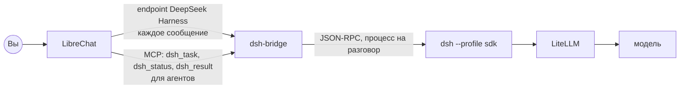

# DeepSeek Harness в LibreChat

DeepSeek Harness (`dsh`) управляется из LibreChat. Отдельный интерфейс `dsh` на порту 3081 остаётся для подробного просмотра.



## Как пользоваться

1. В LibreChat выберите endpoint **DeepSeek Harness** и модель. Это модель, на которой будет работать `dsh`: список берётся из LiteLLM.
2. Напишите задачу. Ход работы идёт в чат по мере выполнения.

| Сообщение | Что делает |
|---|---|
| Любой текст | Новая задача; если агент занят, сообщение встаёт к нему в очередь |
| `да` или `нет` | Ответ на запрос подтверждения |
| Номер варианта или свой текст | Ответ на вопрос агента |
| `/status` или `статус` | Что делает агент, одной строкой |
| `/stop` или `стоп` | Остановить работу; сессия сохраняется |
| `/help` | Подсказка |

Один разговор в LibreChat — одна сессия `dsh`. Следующее сообщение в том же разговоре продолжает ту же сессию.

## Почему так

| Задача | Решение |
|---|---|
| Не тратить токены на стороне LibreChat | Endpoint устроен как OpenAI-совместимая модель: сообщение уходит прямо в `dsh`, модель LibreChat не вызывается. В `dsh` уходит только последнее сообщение: историю он хранит сам. Генерация названий разговоров отключена, потому что иначе она запускала бы `dsh`. |
| Долгие задачи и тайм-ауты | Работа идёт отдельно от HTTP-запроса. Чат лишь наблюдает за ней, а пустые сообщения держат соединение живым. Если соединение оборвалось, работа продолжается, а следующее сообщение (например, `/status`) покажет накопившийся ход. |
| Подтверждения и вопросы | Мост включает в `dsh` подтверждения и вопросы к пользователю и показывает их в чате. Поток останавливается, пока вы не ответите. |
| Отмена | В протоколе SDK нет отмены, поэтому `/stop` закрывает процесс `dsh`. Сессия остаётся на диске, и следующее сообщение продолжает её. |
| Нагрузка | Не больше 4 процессов `dsh` одновременно (`BRIDGE_MAX_RUNTIMES`). Простаивающий процесс закрывается через 15 минут (`BRIDGE_IDLE_SECONDS`), а сессия восстанавливается при следующем сообщении. |
| Изменения в `dsh` | Версия закреплена в `dsh/package-lock.json`. Мост зависит только от протокола SDK и написан на стандартной библиотеке Python. |

## Отображение в чате

Пока используется обычный Markdown: его LibreChat 0.8.8 показывает без доработок.

- **Шапка:** модель и ссылка на интерфейс `dsh`.
- **Вызовы инструментов:** одна строка на вызов, например «▸ `bash` npm test». При ошибке ниже добавляется строка «✗ причина».
- **Текст агента:** приходит после каждого шага.
- **Подтверждения и вопросы:** выделены, у вариантов ответа есть номера.
- **Итог:** число шагов и токены, которые потратил `dsh`.

Рассуждения модели в чат не выводятся, чтобы не засорять его; они видны в интерфейсе `dsh`.

Следующий шаг — интерактивная панель задачи с кнопками «Разрешить» и «Остановить» через MCP Apps. Её можно будет сделать после выхода стабильной LibreChat 0.8.9: в 0.8.8 MCP Apps нет.

## Инструменты для агентов LibreChat

MCP-сервер `dsh` подключён только для агентов (`chatMenu: false`). Ответы короткие, чтобы тратить меньше токенов агента:

| Инструмент | Ответ |
|---|---|
| `dsh_task(task, model?)` | `mcp-1a2b3c4d запущена, модель …` |
| `dsh_status(task_id)` | Одна строка: состояние, шаги, последнее действие |
| `dsh_result(task_id, max_chars?)` | Итоговый ответ, по умолчанию до 1500 символов |

Задачи от агентов идут без человека, поэтому подтверждения в них отклоняются, а вопросы снимаются. Всё, что требует решения человека, запускайте через endpoint DeepSeek Harness.

## Безопасность

`dsh` в профиле SDK выполняет команды без подтверждения: такова его политика по умолчанию. Подтверждения появляются, только если `dsh` сам их запрашивает. Поэтому граница безопасности здесь — контейнер:
- агент видит только рабочую папку `~/llm-stack/dsh-workspace` и свои настройки;
- порт моста наружу не открыт: к нему обращается только LibreChat внутри Docker.

## Проверки

```bash
python3 tests/bridge_unit.py   # подтверждения и вопросы на поддельном процессе dsh
bash tests/bridge.sh           # настоящий dsh и мост с моделью-сценарием, в Docker
```
